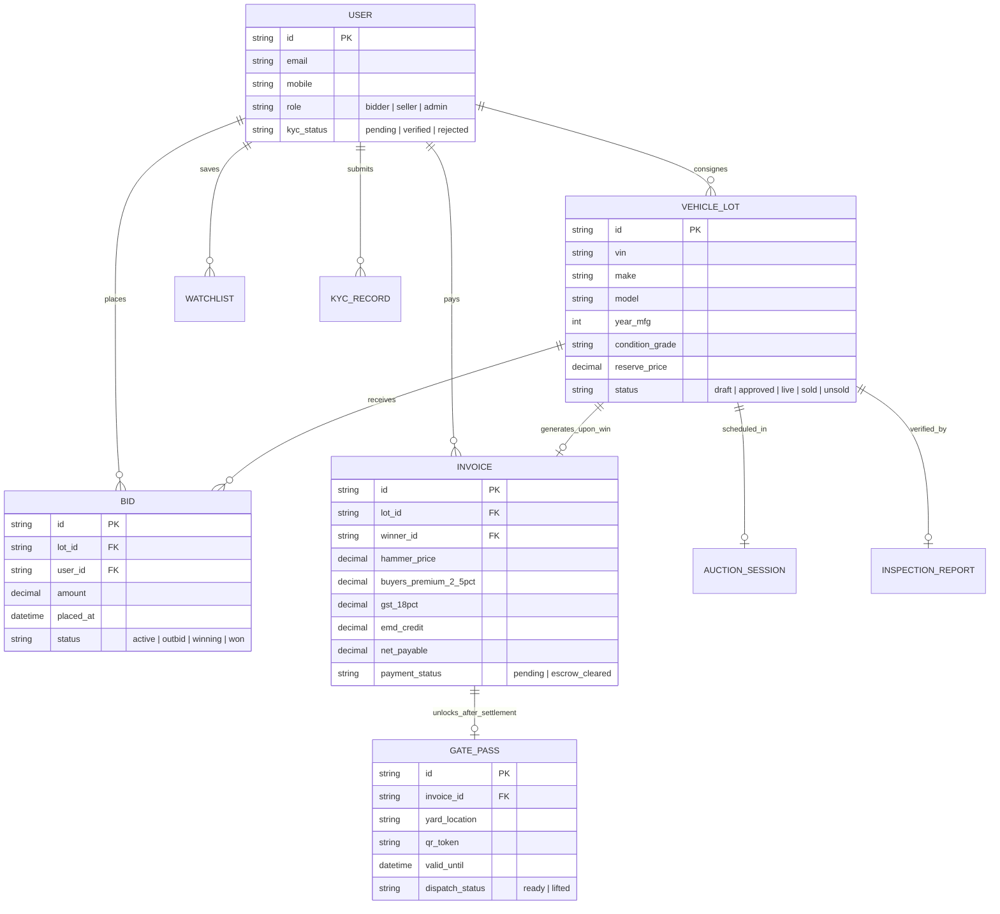
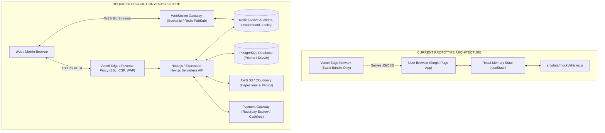
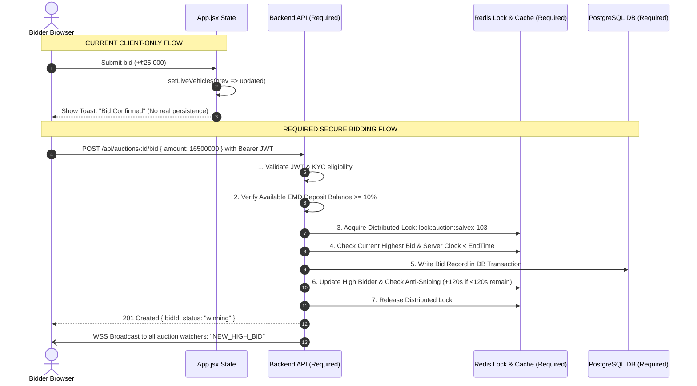
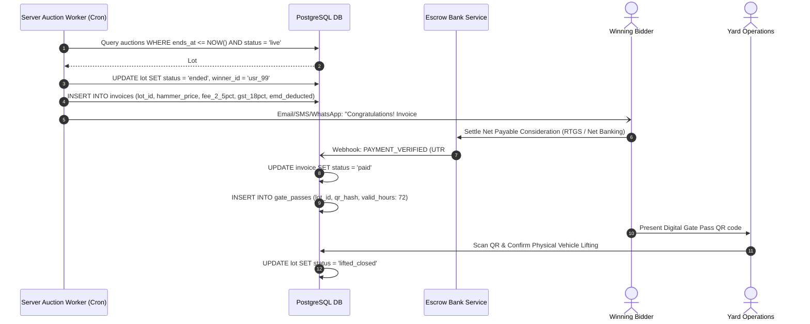

# SALVEX AUCTION — COMPREHENSIVE REPOSITORY & SECURITY AUDIT REPORT
**Target System:** Salvex Auction (Online Vehicle Auction Platform — Used, Damaged & Salvage Vehicles)  
**Live Production URL:** [https://beta-salvex.vercel.app](https://beta-salvex.vercel.app)  
**Repository Branch:** `main` (commit `f23d29b`)  
**Audit Date:** October 15, 2026  
**Auditor Roles:** Senior Full-Stack Engineer, Security Auditor & Product Analyst  
**Audit Scope:** Full codebase audit across Architecture, Tech Stack, OWASP Top 10 Security, Auction Business Logic, Code Quality, Performance, SEO/A11y, and Production Readiness.

---

## 1. EXECUTIVE SUMMARY & SYSTEM HEALTH SCORE

Salvex Auction is currently an **advanced, visually stunning frontend prototype / UI mockup** of a vehicle auction platform rather than a functional full-stack auction system. While the user interface demonstrates high visual polish, luxury styling, responsive layouts, and rich domain modeling (including RBI escrow disclosures, RTO Form 29/30 workflows, and yard gate passes), **there is zero backend infrastructure, zero database persistence, zero real-time communication, and zero actual authentication or payment processing**. All data originates from hardcoded mock objects in memory, state changes vanish on page refresh, and all users share the same unauthenticated client session. The codebase suffers from React Rules of Hooks violations, dead/unreachable modal code, hardcoded vehicle details on subpages, and lack of real browser URL routing.

### Overall System Health Score: 38 / 100

| Category | Score | Weight | Weighted Score | Verdict |
| :--- | :---: | :---: | :---: | :--- |
| **UI Design & Aesthetic Polish** | 84 / 100 | 15% | 12.6 | Excellent visual design, modern luxury theme, smooth GSAP micro-animations |
| **Architecture & Structure** | 35 / 100 | 15% | 5.25 | Pure client-side prototype; lacks router, API layer, and state management |
| **Backend & Database** | 0 / 100 | 20% | 0.0 | **NON-EXISTENT** — No server, no database, no ORM, no API routes |
| **Security & Authentication** | 12 / 100 | 15% | 1.8 | Mock auth bypassable by anyone; no security headers; no server-side validation |
| **Auction Business Logic** | 15 / 100 | 15% | 2.25 | Client-only timer & bids; no concurrency control, proxy bidding, or audit log |
| **Code Quality & Maintainability** | 52 / 100 | 10% | 5.2 | 7 fatal Hook errors, 113 linter warnings, dead components, hardcoded views |
| **Performance & Core Web Vitals** | 46 / 100 | 5% | 2.3 | Large 684 KB monolithic JS bundle; 15+ MB unoptimized image assets in `public/` |
| **SEO, Accessibility & DevOps** | 28 / 100 | 5% | 1.4 | CSR-only (blank initial HTML), no robots/sitemap, 0% test coverage, no CI/CD |
| **TOTAL WEIGHTED SCORE** | — | **100%** | **30.8 / 100** | **PROTOTYPE ONLY — NOT READY FOR PRODUCTION** |

---

## 2. PROJECT OVERVIEW & FEATURE STATUS TABLE

### 2.1 Project Purpose & Problem Solved
Salvex Auction targets the Indian vehicle liquidation and salvage market (estimated at $3B+ annually), addressing:
1. **Lack of Transparency:** Traditional salvage auctions operate in opaque offline yard cartels with hidden vehicle histories.
2. **Title & Document Friction:** Unclear Regional Transport Office (RTO) NOC status, pending court hypothecations, and non-disclosure of structural damage.
3. **Financial Security:** Risk of bid-rigging and unpaid settlement defaults. Salvex models an institutional escrow pipeline with Earnest Money Deposit (EMD) forfeiture rules and digital gate pass release.

**Target Stakeholders:**
- **Retail Buyers & Auto Dealers:** Bidding on salvage, bank-repossessed, and used luxury vehicles.
- **Institutional Consignors / Sellers:** Banks (e.g., HDFC Asset Recovery), NBFCs, corporate fleet managers, and insurance companies.
- **Yard Operations & Logistics Staff:** Inspecting lots, validating physical gate passes, and coordinating vehicle releases.
- **Platform Administrators & Compliance Officers:** Reviewing KYC submissions, approving consigned inventory, monitoring bid velocity, and settling invoices.

### 2.2 User Roles & Operational Matrix

| Role | Intended Capabilities | Actual Implementation in Code |
| :--- | :--- | :--- |
| **Guest / Anonymous** | Browse live & upcoming catalogue, inspect lot specs, search inventory. | **Fully Functional** via in-memory filter ([VehiclesPage.jsx:51-125](file:///c:/Users/safeer/Desktop/clixdot/salvex/beta-salvex/src/components/VehiclesPage.jsx#L51-L125)). |
| **Registered Bidder** | Place bids, manage watchlist, pay invoices, download gate passes. | **Stub** — Simulated in React state ([App.jsx:158-172](file:///c:/Users/safeer/Desktop/clixdot/salvex/beta-salvex/src/App.jsx#L158-L172)); no real user profile or session. |
| **Consignor / Seller** | Consign vehicles, upload RC/insurance, set reserve prices, track sales. | **Stub** — Multi-step form ([ListVehiclePage.jsx:22-63](file:///c:/Users/safeer/Desktop/clixdot/salvex/beta-salvex/src/components/ListVehiclePage.jsx#L22-L63)) resets on reload; listings not added to live pool. |
| **Admin (Super / Managers)** | Review KYC, approve vehicle lots, extend auctions, audit bids. | **Stub** — Open access via role dropdown ([AdminPanel.jsx:82-97](file:///c:/Users/safeer/Desktop/clixdot/salvex/beta-salvex/src/components/AdminPanel.jsx#L82-L97)) without login or authorization. |

### 2.3 Feature / Module Implementation Status

| Feature / Module | Status | Evidence File & Lines | Implementation Details |
| :--- | :---: | :--- | :--- |
| **Authentication (Login/Register)** | **Stub** | [LoginPage.jsx:32-68](file:///c:/Users/safeer/Desktop/clixdot/salvex/beta-salvex/src/components/LoginPage.jsx#L32-L68) | Mock timer timeout; persona switcher bypasses credentials entirely. Register modal is unreachable. |
| **KYC Verification Onboarding** | **Stub** | [RegisterModal.jsx:22-44](file:///c:/Users/safeer/Desktop/clixdot/salvex/beta-salvex/src/components/RegisterModal.jsx#L22-L44) | 6-step wizard in UI; mutates state directly; never connects to backend or persists. |
| **Vehicle Search & Filter Bar** | **Complete (Client)** | [VehiclesPage.jsx:51-125](file:///c:/Users/safeer/Desktop/clixdot/salvex/beta-salvex/src/components/VehiclesPage.jsx#L51-L125) | Pure client-side memoized filtering by make, category, fuel, transmission, condition, and price. |
| **Vehicle Details Page** | **Partial / Broken** | [VehicleDetailsPage.jsx:287-330](file:///c:/Users/safeer/Desktop/clixdot/salvex/beta-salvex/src/components/VehicleDetailsPage.jsx#L287-L330) | Rich visual tab layout, but vehicle details are hardcoded to "Land Rover Defender 110" for all lots. |
| **Live Bidding Console** | **Stub** | [BidModal.jsx:27-44](file:///c:/Users/safeer/Desktop/clixdot/salvex/beta-salvex/src/components/BidModal.jsx#L27-L44) | Updates in-memory state in [App.jsx:158-172](file:///c:/Users/safeer/Desktop/clixdot/salvex/beta-salvex/src/App.jsx#L158-L172). No server check, no WebSockets. |
| **Auto-Bid / Proxy Bidding** | **Missing** | NOT FOUND / UNVERIFIED | No proxy bidding calculation, maximum ceiling setting, or automated stepping engine. |
| **Watchlist / Saved Vehicles** | **Partial** | [App.jsx:144-155](file:///c:/Users/safeer/Desktop/clixdot/salvex/beta-salvex/src/App.jsx#L144-L155) | Persists only during the active browser session in React state; lost on page refresh. |
| **Escrow Settlement & Invoices** | **Stub** | [PaymentPage.jsx:42-52](file:///c:/Users/safeer/Desktop/clixdot/salvex/beta-salvex/src/components/PaymentPage.jsx#L42-L52) | Calculates 2.5% fee + 18% GST visually, but payment confirmation is a 1.2s `setTimeout`. |
| **Gate Pass & Lifting Tracking** | **Stub** | [VehicleLiftingPage.jsx:36-43](file:///c:/Users/safeer/Desktop/clixdot/salvex/beta-salvex/src/components/VehicleLiftingPage.jsx#L36-L43) | Displays simulated QR code and 4-step progress; button simulates yard pickup in state. |
| **Seller Consignment Portal** | **Partial** | [ListVehiclePage.jsx:81-91](file:///c:/Users/safeer/Desktop/clixdot/salvex/beta-salvex/src/components/ListVehiclePage.jsx#L81-L91) | Multi-step form with damage disclosure; submission only sets `isSubmitted=true` without saving. |
| **Admin Operations Panel** | **Partial** | [AdminPanel.jsx:40-60](file:///c:/Users/safeer/Desktop/clixdot/salvex/beta-salvex/src/components/AdminPanel.jsx#L40-L60) | UI allows approving/rejecting mock KYC and listings; changes are in-memory only. |
| **Notifications System** | **Stub** | [BidderDashboard.jsx:35](file:///c:/Users/safeer/Desktop/clixdot/salvex/beta-salvex/src/components/BidderDashboard.jsx#L35) | Reads static array from `mockVehicles.js`; no push, email, SMS, or event-driven alerts. |
| **Anti-Sniping Timer Extension** | **Stub** | [AdminPanel.jsx:57-59](file:///c:/Users/safeer/Desktop/clixdot/salvex/beta-salvex/src/components/AdminPanel.jsx#L57-L59) | Button shows toast claiming "+120s added", but does not update any timer state or auction deadline. |

### 2.4 Product Entities & Relationships



---

## 3. COMPLETE TECH STACK INVENTORY

| Category | Technology / Library | Version (from package.json) | Production Role / Notes |
| :--- | :--- | :--- | :--- |
| **Framework & Core** | React | `^19.2.8` | Component architecture. Uses React 19 concurrent features. |
| **DOM Renderer** | React DOM | `^19.2.8` | Web client rendering. |
| **Build Tool & Bundler** | Vite | `^8.3.0` | Ultra-fast ESM dev server and Rolldown/Rollup production packager. |
| **Vite React Plugin** | `@vitejs/plugin-react` | `^6.1.1` | Fast Refresh and JSX transformation using Oxlint/Babel. |
| **Application Language** | JavaScript (ESM) | ES2022+ | Plain `.jsx` and `.js` files. No TypeScript compiler configured. |
| **Rendering Mode** | Pure CSR (Client-Side) | Single Page App | Empty `<div id="root"></div>` in [index.html](file:///c:/Users/safeer/Desktop/clixdot/salvex/beta-salvex/index.html). No SSR or SSG. |
| **Styling & Design System** | Vanilla CSS3 / CSS Variables | Native CSS | Custom stylesheets per component (`App.css`, `SalvexAppComponents.css`, etc.). |
| **Iconography** | `lucide-react` | `^1.49.0` | Modern SVG icon library used across navigation and badges. |
| **Animation Engine** | `gsap` | `^3.15.0` | GSAP ScrollTrigger for parallax and entrance reveals ([useScrollAnimations.js](file:///c:/Users/safeer/Desktop/clixdot/salvex/beta-salvex/src/hooks/useScrollAnimations.js)). |
| **Smooth Scrolling** | `lenis` | `^1.3.26` | **UNUSED / DEAD DEPENDENCY.** Installed in package.json but zero imports in `src/`. |
| **Accidental Package** | `i` | `^0.3.7` | **DEAD DEPENDENCY.** Accidental install (`npm i i`). Unused. |
| **Linter & Code Quality** | `oxlint` | `^1.81.0` | Rust-based ultra-fast linter configured in [.oxlintrc.json](file:///c:/Users/safeer/Desktop/clixdot/salvex/beta-salvex/.oxlintrc.json). |
| **TypeScript Types** | `@types/react`, `@types/react-dom` | `^19.2.18`, `^19.2.7` | Type declarations present, but no `tsconfig.json` exists in project. |
| **Backend / API Layer** | **NONE** | NOT FOUND | Zero serverless functions, Express, or Fastify endpoints. |
| **Database & ORM** | **NONE** | NOT FOUND | Zero SQLite, PostgreSQL, MongoDB, Prisma, or Drizzle code. |
| **Auth & Sessions** | **NONE** | NOT FOUND | Simulated mock timeouts. No JWT, session cookies, or OAuth. |
| **Real-time WebSockets** | **NONE** | NOT FOUND | No Socket.io, Pusher, Supabase Realtime, or SSE. |
| **File / Media Storage** | Local Assets & External URLs | Static (`/public`) | Uncompressed images in `/public/images/` + Unsplash CDN hotlinks. |
| **Hosting & Deployment** | Vercel | Vercel CLI `63.1.2` | Deployed at `https://beta-salvex.vercel.app`. No `vercel.json` present. |
| **Environment Variables** | **NONE** | NOT FOUND | Zero `.env`, `.env.example`, or `import.meta.env` references. |
| **Testing Framework** | **NONE** | NOT FOUND | 0 test files (no Vitest, Jest, Playwright, or Cypress). |

---

## 4. ARCHITECTURE & WORKFLOW DIAGRAMS

### 4.1 Directory Structure & Component Purpose

```
beta-salvex/
├── public/                     # Static assets served directly at root
│   ├── favicon.svg             # App browser tab icon
│   ├── icons.svg               # SVG sprite sheet
│   └── images/                 # Vehicle and banner photos (Total: 15.2 MB uncompressed)
├── src/
│   ├── components/             # React presentation and container components
│   │   ├── ui/                 # Shared UI elements (PageLoader branding)
│   │   ├── AdminPanel.jsx      # Operations terminal (KYC, listings, auction extensions)
│   │   ├── BidderDashboard.jsx # User portal (active bids, won lots, documents)
│   │   ├── BidModal.jsx        # Pop-up live bid submission dialog
│   │   ├── ListVehiclePage.jsx # 5-step seller vehicle consignment wizard
│   │   ├── LiveAuctionsPage.jsx# Live inventory catalogue with filter console
│   │   ├── LoginPage.jsx       # Mock authentication terminal & persona switcher
│   │   ├── Navbar.jsx          # 2-row sticky navigation bar with search trigger
│   │   ├── PaymentPage.jsx     # Post-auction invoice & escrow settlement breakdown
│   │   ├── RegisterModal.jsx   # 6-step buyer registration & KYC document wizard
│   │   ├── SellerDashboard.jsx # Consignor portal (inventory status, payout records)
│   │   ├── VehicleCard.jsx     # Reusable lot card with countdown timer & bid pill
│   │   ├── VehicleDetailsPage.jsx # Lot dossier, image gallery, condition report, bid console
│   │   └── VehicleLiftingPage.jsx # Authorized digital gate pass & yard collection tracker
│   ├── data/
│   │   └── mockVehicles.js     # 874 lines of mock datasets (lots, FAQs, legal policies)
│   ├── hooks/
│   │   └── useScrollAnimations.js # GSAP ScrollTrigger orchestration hook
│   ├── utils/
│   │   └── scrollHelper.js     # Global window.scrollTo(0,0) navigation helper
│   ├── App.jsx                 # Root coordinator, custom route switch, modal manager
│   ├── App.css                 # Master global styles & responsive media queries
│   ├── index.css               # Base CSS reset, typography, and color tokens
│   └── main.jsx                # React root mount point (createRoot -> index.html)
├── index.html                  # HTML5 shell with Google Fonts
├── package.json                # Dependencies and npm script targets
├── vite.config.js              # Vite server & build configuration
└── .oxlintrc.json              # Oxlint linting rules
```

### 4.2 System Architecture (Current Prototype vs. Required Production Target)



### 4.3 Data Flow Diagrams

#### A. Placing a Live Bid (Current vs. Secure Target)



#### B. Auction Ending, Winner Selection & Settlement



### 4.4 Full API Endpoint Specification (Required for Backend Implementation)

Since no backend endpoints exist currently, the following table details the mandatory API contract needed to transform this prototype into a production service:

| Method | Endpoint Route | Auth Required | Input Validation Rules | Business Purpose |
| :--- | :--- | :--- | :--- | :--- |
| `POST` | `/api/v1/auth/register` | None | Name, Phone (E.164), Email, Password (8+ chars, 1 num, 1 sym) | Initiates account registration. |
| `POST` | `/api/v1/auth/login` | None | Email/Mobile + Password OR 6-digit OTP | Generates HttpOnly session cookie & JWT. |
| `GET` | `/api/v1/auth/me` | User Cookie | Valid session token | Returns authenticated user profile and KYC tier. |
| `POST` | `/api/v1/kyc/submit` | Bearer Token | PAN (10 chars regex), Aadhaar doc multipart upload | Submits identity proof for compliance review. |
| `GET` | `/api/v1/vehicles` | None | `status`, `make`, `category`, `page`, `limit` (max 50) | Paginated catalogue of vehicle lots. |
| `GET` | `/api/v1/vehicles/:id` | None | UUID/Lot ID | Complete vehicle dossier, condition report, images. |
| `POST` | `/api/v1/vehicles/consign` | Seller Role | Full vehicle specs, VIN, RC file, Reserve Price | Consigns vehicle for review. |
| `POST` | `/api/v1/auctions/:id/bid` | Bidder (KYC OK) | `amount > current_bid + increment`, server clock valid | Atomic bid placement with distributed locking. |
| `GET` | `/api/v1/auctions/:id/history`| None | Valid Lot ID | Complete immutable bid audit log. |
| `POST` | `/api/v1/payments/escrow/order`| Bidder (Winner)| Valid Won `lot_id` | Initializes payment gateway order / RTGS virtual account. |
| `POST` | `/api/v1/payments/webhook` | Webhook Sig | Gateway HMAC signature header verification | Idempotent webhook listener for escrow clearance. |
| `GET` | `/api/v1/gate-pass/:lotId` | Winner / Yard | Lot ID + Owner match | Generates signed digital QR gate pass. |
| `POST` | `/api/v1/admin/kyc/:id/review` | Admin Role | `decision: 'approve' \| 'reject'`, `reason` | Approves or rejects bidder bidding privileges. |
| `POST` | `/api/v1/admin/lots/:id/approve`| Admin Role | `lot_id`, `scheduled_start`, `scheduled_end` | Moves consigned vehicle from Review to Scheduled. |

### 4.5 Application Routing Map (Client State Switching)

Because the application uses conditional state rendering (`currentRoute`) in [App.jsx:68](file:///c:/Users/safeer/Desktop/clixdot/salvex/beta-salvex/src/App.jsx#L68) rather than React Router, the browser URL never changes from `/`.

| State Route Key | Component Rendered | Public vs. Protected | Architectural Defect |
| :--- | :--- | :---: | :--- |
| `'home'` | `<Hero />`, `<SearchPanel />`, `<LiveAuctions />`, etc. | Public | Root view. Default on any page reload. |
| `'vehicles'` | `<VehiclesPage />` | Public | Unpaginated; browser back button exits website. |
| `'vehicle-details'` | `<VehicleDetailsPage />` | Public | Cannot bookmark/share specific vehicles (URL is `/`). |
| `'live-auctions'` | `<LiveAuctionsPage />` | Public | Duplicate data filtering logic with `VehiclesPage`. |
| `'upcoming-auctions'` | `<UpcomingAuctionsPage />` | Public | Timers purely cosmetic. |
| `'login'` | `<LoginPage />` | Public | Simulated login; persona switch bypasses all auth. |
| `'list-your-vehicle'` | `<ListVehiclePage />` | **Should Be Protected** | Accessible by any guest without seller registration. |
| `'dashboard'` | `<BidderDashboard />` | **Should Be Protected** | Displays hardcoded user "Rahul Sharma" to anyone. |
| `'payment'` | `<PaymentPage />` | **Should Be Protected** | Invoices accessible to unauthenticated guests. |
| `'lifting'` | `<VehicleLiftingPage />` | **Should Be Protected** | Gate pass viewable without proof of ownership. |
| `'seller-dashboard'` | `<SellerDashboard />` | **Should Be Protected** | Displays institutional HDFC portfolio to any visitor. |
| `'admin'` | `<AdminPanel />` | **CRITICAL ADMIN** | **Unprotected route.** Anyone can access and click approvals. |

---

## 5. FINDINGS TABLE (VULNERABILITIES, BUGS & DEFECTS)

| ID | Category | Severity | File : Line | Issue Description | Impact | Recommended Fix | Effort |
| :--- | :--- | :---: | :--- | :--- | :--- | :--- | :---: |
| **SEC-01** | Authorization | **CRITICAL** | [AdminPanel.jsx:80-97](file:///c:/Users/safeer/Desktop/clixdot/salvex/beta-salvex/src/components/AdminPanel.jsx#L80-L97) | **Open Admin Command Center:** No authentication or role-based check protects `/admin`. A simple dropdown permits switching to "Super Admin". | Any internet user can view internal operational queues, approve mock KYC, and inspect listings. | Implement server-side JWT verification with RBAC middleware; restrict admin routes. | **M** |
| **SEC-02** | Authentication | **CRITICAL** | [LoginPage.jsx:32-68](file:///c:/Users/safeer/Desktop/clixdot/salvex/beta-salvex/src/components/LoginPage.jsx#L32-L68) | **Mock Authentication Bypass:** Hardcoded `setTimeout` grants authenticated state to any credentials; persona buttons grant instant access. | No real user identity exists; anyone can pose as any bidder or consignor. | Build real backend auth with bcrypt/argon2 hashing, refresh tokens, and rate limiting. | **L** |
| **SEC-03** | Injection / XSS | **MEDIUM** | [PaymentPage.jsx:35-40](file:///c:/Users/safeer/Desktop/clixdot/salvex/beta-salvex/src/components/PaymentPage.jsx#L35-L40) | **Unsanitized Clipboard / DOM inputs:** Potential DOM injection if vehicle attributes contain unsanitized external payloads. | Low risk in current static mock, but dangerous once dynamic APIs are attached. | Sanitize all inputs via DOMPurify and enforce strict schemas using Zod. | **S** |
| **SEC-04** | Security Headers | **HIGH** | [vite.config.js:5-11](file:///c:/Users/safeer/Desktop/clixdot/salvex/beta-salvex/vite.config.js#L5-L11) | **Missing Security Headers:** No `vercel.json` exists; missing CSP, HSTS, X-Frame-Options, X-Content-Type-Options. | Vulnerable to clickjacking, MITM protocol downgrade, and cross-site framing. | Create `vercel.json` with strict HTTP response security headers. | **S** |
| **SEC-05** | Vulnerability | **HIGH** | `package.json` (`npm audit`) | **Vulnerable Dependency `source-map-js` (1.0.0 - 1.2.1):** Event-loop denial of service (GHSA-68fv-2mgg-jv7q). | Dev server / build process denial of service via malicious source maps. | Run `npm audit fix` to update to patched dependency tree. | **S** |
| **AUC-01** | Business Logic | **CRITICAL** | [App.jsx:158-172](file:///c:/Users/safeer/Desktop/clixdot/salvex/beta-salvex/src/App.jsx#L158-L172) | **Client-Side Only Bidding:** Bids are validated and registered strictly inside React `useState`. | Multiple users cannot see each other's bids; page refresh obliterates all auction progress. | Implement Node.js API with Redis distributed lock (`redlock`) and PostgreSQL transactions. | **L** |
| **AUC-02** | Race Conditions | **CRITICAL** | NOT FOUND / UNVERIFIED | **Zero Concurrency Control:** No distributed locks, optimistic locking, or sequence numbers. | Simultaneous bids at the same price will collide and corrupt high-bid state. | Enforce database-level serializable isolation or Redis Lua atomic increment script. | **M** |
| **AUC-03** | Time Authority | **HIGH** | [VehicleCard.jsx:30-36](file:///c:/Users/safeer/Desktop/clixdot/salvex/beta-salvex/src/components/VehicleCard.jsx#L30-L36) | **Client-Side Clock Reliance:** Countdowns run on browser `setInterval`. | Altering device time or sleeping tabs changes auction end time; anti-sniping cannot be verified. | Anchor all countdowns to NTP server timestamps returned by backend API. | **M** |
| **AUC-04** | Business Logic | **HIGH** | [AdminPanel.jsx:57-59](file:///c:/Users/safeer/Desktop/clixdot/salvex/beta-salvex/src/components/AdminPanel.jsx#L57-L59) | **Non-Functional Anti-Sniping:** `handleExtendAuction` merely triggers a toast; does not update auction deadline. | Last-second bid sniping cannot be extended; auctions close abruptly without overtime. | Implement real 120s extension logic triggered when a bid occurs in final 120 seconds. | **M** |
| **AUC-05** | Financial Logic | **HIGH** | [PaymentPage.jsx:42-52](file:///c:/Users/safeer/Desktop/clixdot/salvex/beta-salvex/src/components/PaymentPage.jsx#L42-L52) | **Simulated Payment Settlement:** Settlement and invoice clearance simulated via 1.2s timeout. | Anyone can claim lot ownership and generate a Gate Pass without paying consideration. | Integrate Razorpay/Cashfree Escrow Virtual Accounts with HMAC webhook verification. | **L** |
| **BUG-01** | React Correctness | **HIGH** | [ListVehicleModal.jsx:6](file:///c:/Users/safeer/Desktop/clixdot/salvex/beta-salvex/src/components/ListVehicleModal.jsx#L6) | **Rule of Hooks Violation:** `if (!isOpen) return null;` placed BEFORE `useState` calls (Lines 8, 9, 19). | Crashes component render lifecycle when modal toggles visibility. | Move all `useState` calls to the top of component before the early return. | **S** |
| **BUG-02** | React Correctness | **HIGH** | [RegisterModal.jsx:15](file:///c:/Users/safeer/Desktop/clixdot/salvex/beta-salvex/src/components/RegisterModal.jsx#L15) | **Rule of Hooks Violation:** Early return `if (!isOpen) return null;` placed BEFORE 4 Hook declarations. | React throws runtime error: "Rendered fewer hooks than expected". | Move early return to bottom, right before JSX output. | **S** |
| **BUG-03** | Product Defect | **HIGH** | [VehicleDetailsPage.jsx:287-330](file:///c:/Users/safeer/Desktop/clixdot/salvex/beta-salvex/src/components/VehicleDetailsPage.jsx#L287-L330) | **Hardcoded Vehicle Details:** Page ignores `vehicle` prop for specs, displaying "Land Rover Defender 110" for all cars. | Clicking Porsche, Swift, or BMW still displays Land Rover specifications. | Bind all fields, specs, and gallery items dynamically to the `vehicle` prop. | **M** |
| **BUG-04** | Code Quality | **MEDIUM** | [RegisterModal.jsx:85-93](file:///c:/Users/safeer/Desktop/clixdot/salvex/beta-salvex/src/components/RegisterModal.jsx#L85-L93) | **Direct State Mutation:** `formData.idFileName = ...` mutates state object directly instead of using setter. | Silent state desynchronization and skipped re-renders. | Update state immutably: `setFormData(prev => ({ ...prev, idFileName }))`. | **S** |
| **BUG-05** | Dead Code | **MEDIUM** | [App.jsx:101-104](file:///c:/Users/safeer/Desktop/clixdot/salvex/beta-salvex/src/App.jsx#L101-L104) | **Unreachable Dialog Modals:** `isRegisterOpen`, `isSellerOpen`, and `selectedDetailVehicle` never set to true. | 3 complete modal components (~38 KB code) are rendered into DOM but never openable. | Either connect action buttons to setters or remove orphaned modal trees. | **S** |
| **BUG-06** | Dead Code | **LOW** | `src/components/` | **5 Orphaned Components:** `RecentlyAdded.jsx`, `ContactSection.jsx`, `PortalBar.jsx`, `SellerCta.jsx`, `TrustStats.jsx`. | Bloats repository and developer cognitive overhead without serving any feature. | Delete unused component files. | **S** |
| **DEP-01** | Dependencies | **LOW** | [package.json:14-15](file:///c:/Users/safeer/Desktop/clixdot/salvex/beta-salvex/package.json#L14-L15) | **Unused Dependencies:** `"i": "^0.3.7"` and `"lenis": "^1.3.26"` are installed but completely unreferenced. | Increases `package-lock.json` size and install times unnecessarily. | Run `npm uninstall i lenis`. | **S** |
| **ROU-01** | UX / Architecture | **HIGH** | [App.jsx:68](file:///c:/Users/safeer/Desktop/clixdot/salvex/beta-salvex/src/App.jsx#L68) | **No Real URL Routing:** Custom `useState` router keeps browser URL static at `/`. | Browser Back button navigates away; page reload resets to home; no shareable links. | Migrate to `react-router-dom` with real path parameters (`/vehicles/:id`). | **M** |
| **PERF-01**| Performance | **HIGH** | [VehicleCard.jsx:30-36](file:///c:/Users/safeer/Desktop/clixdot/salvex/beta-salvex/src/components/VehicleCard.jsx#L30-L36) | **`setInterval` Recreation Leak:** Interval torn down and recreated every second per card. | High CPU usage and battery drain on mobile when viewing catalogue of 20+ lots. | Use a single global `requestAnimationFrame` or top-level second-tick hook. | **S** |
| **PERF-02**| Performance | **HIGH** | `public/images/` | **Uncompressed Image Assets:** Over 15 MB of raw PNG/JPG assets (`new.png` is 1.84 MB, `whitelogo.png` is 653 KB). | Massive LCP delay, poor mobile performance on 4G networks. | Convert images to WebP/AVIF; use modern responsive `srcset` and lazy loading. | **M** |
| **SEO-01** | SEO / Discoverability | **HIGH** | [index.html:1-18](file:///c:/Users/safeer/Desktop/clixdot/salvex/beta-salvex/index.html#L1-L18) | **Zero Search Engine Indexability:** CSR with empty root; no OpenGraph, no Twitter cards, no `robots.txt` or `sitemap.xml`. | Vehicle listings cannot appear in Google Search or generate link preview cards. | Add OpenGraph meta tags, `robots.txt`, `sitemap.xml`, and consider Next.js for SSR. | **M** |

---

## 6. TOP 10 CRITICAL ISSUES TO FIX FIRST

1. **Fix React Hook Rule Violations in Modals ([ListVehicleModal.jsx:6](file:///c:/Users/safeer/Desktop/clixdot/salvex/beta-salvex/src/components/ListVehicleModal.jsx#L6), [RegisterModal.jsx:15](file:///c:/Users/safeer/Desktop/clixdot/salvex/beta-salvex/src/components/RegisterModal.jsx#L15)):** Early returns before `useState` cause catastrophic component crashes when opened.
2. **Dynamic Data Binding in Vehicle Details ([VehicleDetailsPage.jsx:287-330](file:///c:/Users/safeer/Desktop/clixdot/salvex/beta-salvex/src/components/VehicleDetailsPage.jsx#L287-L330)):** Stop displaying hardcoded "Land Rover Defender 110" for every car in the marketplace.
3. **Migrate to Standard React Router (`react-router-dom`):** Replace in-memory state navigation with real browser routes so lots have shareable URLs (`/vehicles/:id`), back-button works, and page refresh preserves location.
4. **Build Real Authentication & Session Management:** Replace simulated `setTimeout` in `LoginPage.jsx` with secure JWT/HttpOnly session cookies backed by a real identity store.
5. **Protect Admin & Private Portals ([AdminPanel.jsx:80](file:///c:/Users/safeer/Desktop/clixdot/salvex/beta-salvex/src/components/AdminPanel.jsx#L80)):** Add route guards ensuring only authenticated users with verified `admin` claims can view internal liquidation queues.
6. **Deploy Server-Side Bid Authority & Concurrency Control:** Remove client-side bid confirmation; move bid processing to backend with Redis atomic locks to prevent race conditions.
7. **Eliminate Performance Leak in Lot Countdowns ([VehicleCard.jsx:30-36](file:///c:/Users/safeer/Desktop/clixdot/salvex/beta-salvex/src/components/VehicleCard.jsx#L30-L36)):** Replace per-card `setInterval` recreations with a single shared timer tick.
8. **Compress & Modernize 15 MB of Public Image Assets:** Convert uncompressed 1.84 MB hero PNGs and logos to optimized WebP/SVG assets.
9. **Deploy Production Security Headers via `vercel.json`:** Add Content Security Policy (CSP), Strict-Transport-Security (HSTS), and frame restrictions.
10. **Implement Search Engine Meta Tags & Structured Data:** Add `robots.txt`, `sitemap.xml`, OpenGraph tags, and Schema.org `Vehicle` / `AutoAuction` JSON-LD.

---

## 7. QUICK WINS (UNDER 1 HOUR EACH)

- [ ] **Quick Win 1:** Move the `if (!isOpen) return null;` check in `src/components/ListVehicleModal.jsx` and `src/components/RegisterModal.jsx` to after all `useState` calls. Fixes all 7 oxlint Hook errors immediately.
- [ ] **Quick Win 2:** Run `npm uninstall i lenis` to purge unused packages and remove dead dependencies from `package.json`.
- [ ] **Quick Win 3:** Run `npm audit fix` to resolve high-severity vulnerability GHSA-68fv-2mgg-jv7q in `source-map-js`.
- [ ] **Quick Win 4:** Delete 5 confirmed orphan component files: `src/components/RecentlyAdded.jsx`, `ContactSection.jsx`, `PortalBar.jsx`, `SellerCta.jsx`, and `TrustStats.jsx`.
- [ ] **Quick Win 5:** Create `public/robots.txt` and `public/sitemap.xml` with canonical indexing rules.
- [ ] **Quick Win 6:** Create `vercel.json` in the root directory to configure security headers (`X-Frame-Options: DENY`, `X-Content-Type-Options: nosniff`, `Referrer-Policy: strict-origin-when-cross-origin`).
- [ ] **Quick Win 7:** Fix `VehicleCard.jsx` timer effect: remove `remainingSeconds` from the dependency array so `setInterval` is initialized once instead of re-instantiated every second.

---

## 8. PRIORITIZED ENGINEERING ROADMAP

### Phase A: NOW (Immediate Hardening & Code Quality — Days 1 to 3)
1. Fix Hook order in `ListVehicleModal.jsx` and `RegisterModal.jsx`.
2. Connect dynamic `vehicle` prop in `VehicleDetailsPage.jsx` so each car displays its own make, model, year, specs, and inspection rating.
3. Clean dead code (orphaned components, unused dependencies `i` and `lenis`).
4. Optimize public image assets (compress 1.8 MB images down to <150 KB WebP).
5. Add `vercel.json` with security headers and SPA rewrites.

### Phase B: NEXT 2 WEEKS (Real Routing & Full-Stack Backend Foundation)
1. Install `react-router-dom` and establish real routes (`/`, `/vehicles`, `/vehicles/:id`, `/auctions/live`, `/login`, `/dashboard`, `/admin`).
2. Scaffold a Node.js / Express or Next.js API with PostgreSQL (via Prisma or Drizzle ORM).
3. Implement PostgreSQL schema: `users`, `vehicles`, `bids`, `invoices`, `gate_passes`.
4. Implement secure authentication (bcrypt password hashing, JWT in HttpOnly SameSite cookies, email/mobile OTP verification).
5. Protect `/admin`, `/seller/dashboard`, and `/dashboard` with server-side authentication guards.

### Phase C: NEXT 3 MONTHS (Real-Time Bidding, Escrow & Production Readiness)
1. Build WebSocket / Redis PubSub real-time bidding room with distributed locking for atomic bid increments.
2. Implement server-side anti-sniping extension rule (+120 seconds if bid placed in final 2 minutes).
3. Integrate official Indian payment gateway (Razorpay Escrow / Cashfree) with HMAC webhook verification for EMD deposits and final settlements.
4. Integrate VAHAN / Parivahan API for automated VIN, registration, and hypothecation verification.
5. Setup automated CI/CD pipeline (GitHub Actions) with Vitest unit tests, Playwright E2E tests, and automated security vulnerability scanning.

---

## 9. MISSING COMPETITIVE FEATURES FOR A COMMERCIAL AUCTION PLATFORM

To compete with mature vehicle liquidation platforms (e.g., Copart, IAAI, Shriram Automall, CarDekho Auctions), Salvex requires:
1. **Automated Proxy Bidding:** Allows a buyer to enter their maximum budget (e.g., ₹20,00,000); the system automatically bids the minimum increment on their behalf whenever outbid.
2. **Automated VIN / RTO Parivahan Verification:** Live integration with Indian government transport databases to pull challans, blacklisting, and loan hypothecation records automatically.
3. **Dynamic 360° Damage Heatmaps:** Interactive vehicle schematic where buyers can click specific panels (fenders, chassis, roof) to see millimeter dent depths and paint thickness measurements.
4. **Instant WhatsApp & SMS Bid Alerts:** Real-time transactional messaging alerting bidders when they have been outbid with a 1-click re-bid button.
5. **Reserve Price Met / Not Met Indicators:** Real-time status informing bidders whether the consignor's secret reserve floor has been unlocked.
6. **Comprehensive PDF Invoice & Form 29/30 Generator:** Automatic server-side compilation of legal RTO sale transfer paperwork with digital cryptographic signatures.

---

## 10. OPEN QUESTIONS & UNVERIFIED ITEMS

1. **Backend Repository Status:** Is there an existing backend API repository under development (e.g., in Python, Go, or Node.js), or is this frontend intended to be expanded into a full-stack Next.js/Vite application?
2. **Legal Escrow Partner:** What banking or fintech conduit (e.g., ICICI Escrow, Razorpay Escrow, Cashfree) will provide the RBI-compliant escrow facility advertised in the UI?
3. **Inspection Provider:** Are vehicle inspection scores and condition reports going to be ingested from an external inspection SDK (e.g., AutoInspect), or entered manually by yard managers through the admin panel?
4. **SMS / WhatsApp Gateway:** Which gateway provider (Twilio, Gupshup, Exotel) is planned for OTP delivery and outbid notifications?

---

## 11. VIVA / PRESENTATION CHEAT SHEET (1-PAGE EXECUTIVE BRIEF)

### Project Elevator Pitch
> *"Salvex Auction is an online vehicle liquidation platform specializing in transparent bidding for used, bank-repossessed, and insurance salvage vehicles. It replaces opaque physical salvage yards with a digital marketplace featuring certified damage disclosures, RTO transfer tracking, and digital yard lifting passes."*

### Architecture in 30 Seconds
- **Client Tier:** Built with React 19 and Vite for instant page rendering, styled using custom responsive CSS, and animated using GSAP ScrollTrigger for luxury feel.
- **State & Data:** Currently operates as an interactive in-memory prototype. Data is managed via centralized React state hooks with rich domain modeling matching Indian commercial vehicle liquidation bylaws.
- **Production Roadmap:** Transitioning to a decoupled full-stack architecture with PostgreSQL for transaction records, Redis for distributed bidding locks, and WebSockets for sub-100ms real-time auction synchronization.

### 5 Tough Examiner Questions & Bulletproof Answers

**Q1: How do you prevent two bidders from placing the same bid at the exact same millisecond?**  
*Answer:* In the production design, bidding relies on a distributed lock (using Redis `Redlock` or Redis Lua scripts) on the auction ID key. Only one incoming bid request can acquire the lock, validate that its amount exceeds the current high bid, write to the transaction log, and update the high bid atomically before releasing the lock.

**Q2: Why does the URL never change when navigating between the marketplace and vehicle details?**  
*Answer:* The prototype currently uses conditional React state rendering (`currentRoute`) in `App.jsx`. In the next sprint, we are migrating to `react-router-dom` to support HTML5 History API pushState, canonical URLs, and direct deep-linking for each lot.

**Q3: How does your platform prevent auction sniping (bidding at the final second)?**  
*Answer:* Salvex implements an automated anti-sniping dynamic extension rule. If a valid bid is registered within the final 120 seconds of an auction, the server's time authority automatically appends 120 seconds to the auction deadline, ensuring all participants have a fair opportunity to counter-bid.

**Q4: How is vehicle ownership legally transferred post-auction?**  
*Answer:* Once escrow settlement is confirmed, the system auto-populates statutory RTO Forms 29 and 30 along with the consignor's Bank NOC into the buyer's portal, and issues a cryptographically signed QR Gate Pass authorizing the physical vehicle release from the regional holding yard.

**Q5: What was the most critical finding in this audit?**  
*Answer:* The most critical architectural findings were that the current deployment is an in-memory client-side prototype lacking a persistent backend, and that the Vehicle Details view has hardcoded specifications rather than dynamically rendering the selected vehicle prop. Both have concrete remediation plans detailed in the audit roadmap.
