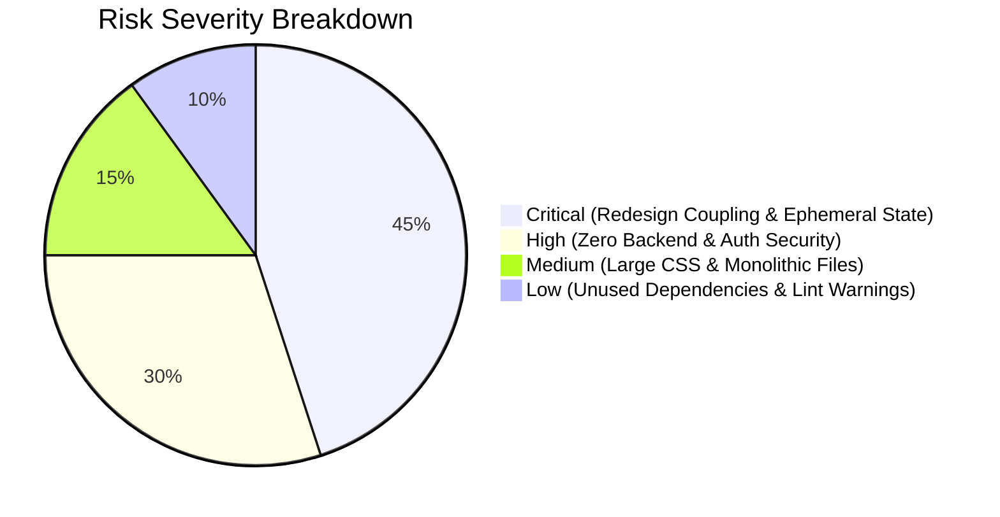

# 00 - EXECUTIVE SUMMARY: SALVEX AUCTION TECHNICAL AUDIT

**Audit Type:** Deep Senior Staff Technical Due Diligence & Architecture Assessment  
**Repository:** `beta-salvex` (`new@0.0.0`)  
**Auditor:** Senior Staff Engineer & Technical Auditor  
**Date:** October 20, 2026  
**Audited Target:** Entire React/Vite SPA (`src/`, `public/`, config & toolchain)  
**Workspace Policy:** STRICT READ-ONLY on codebase; audit artifacts exclusively placed in `/docs/audit/`.

---

## 1. Overall System Health Score

| Dimension | Score (1-10) | Rating | Primary Observation |
| :--- | :---: | :---: | :--- |
| **Visual Fidelity & Interaction** | **9.0 / 10** | Excellent | Highly polished luxury auction interface, rich modals, complete styling, GSAP animations. |
| **Functional Completeness (UI flows)** | **8.5 / 10** | High | Complete user journeys: catalog browsing, bid execution, simulated checkout, gate pass generation, seller listing flow, and operational admin desk. |
| **Architecture & Separation of Concerns** | **4.0 / 10** | Poor | Giant monolithic components (e.g. `VehicleDetailsPage.jsx` has 1,356 lines, `BidderDashboard.jsx` has 873 lines); UI view logic, form handlers, mock mutations, and modal states coexist in single files. |
| **Design Change / Redesign Readiness** | **3.5 / 10** | Critical Risk | Heavy coupling between specific JSX layout structures and large vanilla CSS rule files (`App.css` 91KB, `SalvexAppComponents.css` 58KB, `VehicleDetailsPage.css` 28KB). Modifying design requires untangling intertwined CSS selectors. |
| **State Management & Data Persistence** | **3.0 / 10** | Mock Only | Entirely in-memory React `useState` seeded from static files (`src/data/mockVehicles.js`). Refreshing the browser resets all bids, watchlists, admin approvals, and listings. |
| **Backend Integration & Security** | **1.0 / 10** | Non-Existent | Zero HTTP client, zero backend endpoints, zero authentication tokens/cookies, simulated credentials accept any input. |
| **Type Safety & Testing** | **1.0 / 10** | Non-Existent | JavaScript (ESM JSX) without TypeScript; zero automated unit, integration, or E2E tests configured. |
| **Overall Production Readiness Score** | **3.8 / 10** | **Prototype / Client Demo Stage** |

---

## 2. Executive Synthesis

The **Salvex Auction** application is a **high-fidelity frontend client prototype** representing an Indian automotive and equipment salvage/liquidation bidding exchange. It showcases end-to-end user workflows:
1. Public multi-parameter vehicle search and live auction viewing.
2. Real-time bidding interface with anti-sniping countdown logic and custom bid increments.
3. Post-auction institutional workflows: won lot settlements, invoice breakdowns (GST, buyer's premium, EMD credits), and digital yard gate pass issuance with QR clearance.
4. Seller vehicle listing submission workflow and multi-role operations/admin management console.

### Key Finding for Incoming Engineers
**The visual prototype is functionally interactive in the browser, but it is 100% ephemeral and disconnected from any backend.** Every interaction (bidding, KYC verification, listing approval, gate pass clearance) merely modifies local component state in memory. 

Furthermore, **the current design is not final**. Because styling was written as extensive bespoke vanilla CSS files matching exact classnames and DOM hierarchies, future visual redesigns will require significant effort unless component presentation is refactored into modular UI primitives.

---

## 3. Top 5 Urgent Risks & Blockers

1. **Monolithic Component & CSS Architecture (Design-Change Hazard):**
   - *Evidence:* `VehicleDetailsPage.jsx` (1,356 LOC) and its stylesheet `VehicleDetailsPage.css` (28KB), along with `App.css` (91KB, 3,900+ lines).
   - *Impact:* Visual redesigns will require rewriting large CSS files where typography, layout grids, and business logic are deeply coupled.
2. **Fragile In-Memory Virtual Routing:**
   - *Evidence:* `src/App.jsx:68` (`useState('home')`).
   - *Impact:* The application does not use browser history (`react-router-dom` is absent). Users cannot bookmark specific vehicle URLs (`/vehicles/salvex-103`), browser back/forward buttons break the navigation flow, and page reloads always reset to the homepage.
3. **Zero Data Persistence & Ephemeral Transactions:**
   - *Evidence:* `src/App.jsx:63-64` (`useState(liveVehiclesData)`).
   - *Impact:* No REST or GraphQL APIs, no WebSocket connection for live bids, and no `localStorage`/`IndexedDB`. Any page reload destroys placed bids, seller submissions, and payment states.
4. **Simulated Authentication & Zero Access Controls:**
   - *Evidence:* `src/components/LoginPage.jsx:36-56` and `src/App.jsx:358-361`.
   - *Impact:* Entering any credentials logs the user in; clicking "Super Admin" bypasses all security and grants access to `AdminPanel.jsx`.
5. **Ghost & Misnamed Dependencies:**
   - *Evidence:* `package.json:14` contains dependency `"i": "^0.3.7"` (accidental typo install of an obscure npm package), and `"lenis": "^1.3.26"` is installed but never imported in `src/`.

---

## 4. Top 5 Strategic Recommendations for the Engineering Team

1. **Adopt a Standard Routing Framework (Next.js or React Router v7):**
   Replace the `currentRoute` state in `App.jsx` with real URL routes (`/`, `/vehicles/:id`, `/auctions/live`, `/dashboard`, `/admin`). This allows deep linking, browser history support, and SSR/SSG for SEO.
2. **Decouple Business Logic into Custom Hooks & State Containers:**
   Extract bidding mechanics, countdown timers, and filtering logic out of UI view files into headless hooks (e.g., `useAuctionBid(lotId)`, `useAuctionTimer(endsAt)`).
3. **Establish a Normalized Design System:**
   Clean up hardcoded color strings (e.g., `#075BFF`, `#0B1220`, `#16A344`, `#DC2626`) across the 15+ standalone CSS files and consolidate them into design tokens inside `src/index.css`.
4. **Implement Real Backend Contracts & SWR / React Query:**
   Define OpenAPI / TypeScript interfaces for `Vehicle`, `AuctionLot`, `Bid`, `Invoice`, and `UserSession`. Replace `src/data/mockVehicles.js` with TanStack Query hooks.
5. **Clean Up Toolchain Hygiene:**
   Remove `"i"` and unused packages from `package.json`, configure ESLint/TypeScript for type safety, and fix the 105 Oxlint warnings.
