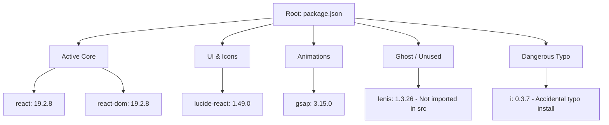

# 02 - SETUP, ENVIRONMENT & RUNTIME REQUIREMENTS

**Audited Target:** `beta-salvex` (`package.json`, `vite.config.js`, `.oxlintrc.json`)  
**Auditor:** Senior Staff Engineer

---

## 1. Tech Stack Overview

| Category | Technology | Version Specified | Actual Resolved |
| :--- | :--- | :--- | :--- |
| **Runtime Environment** | Node.js | Unspecified in `package.json` | >= 20.x recommended |
| **Framework** | React | `^19.2.8` | React 19.2.8 (Latest canary/v19 major release) |
| **DOM Renderer** | React DOM | `^19.2.8` | 19.2.8 |
| **Build Tool & Dev Server** | Vite | `^8.3.0` | Vite 8.3.1 |
| **Vite React Plugin** | `@vitejs/plugin-react` | `^6.1.1` | Uses `@babel/core` & Fast Refresh |
| **Icons Library** | `lucide-react` | `^1.49.0` | 1.49.0 |
| **Animation Engine** | `gsap` | `^3.15.0` | 3.15.0 (ScrollTrigger plugin used) |
| **Smooth Scrolling** | `lenis` | `^1.3.26` | 1.3.26 (Unused ghost dependency) |
| **Linter** | `oxlint` | `^1.81.0` | 1.81.0 (Rust-based ultra-fast linter) |
| **Styling Solution** | Vanilla CSS | Standard CSS3 | Plain CSS across 15+ files |

---

## 2. Dependency Audit & Health Check



### Detailed Dependency Table:
| Package Name | Specified Version | Purpose in Codebase | Actively Used? | Audit Finding / Health Assessment |
| :--- | :--- | :--- | :---: | :--- |
| `react` | `^19.2.8` | Primary UI library | **YES** | React 19 is fully functional. |
| `react-dom` | `^19.2.8` | DOM rendering target | **YES** | Mounted in `src/main.jsx:6`. |
| `lucide-react` | `^1.49.0` | UI vector iconography | **YES** | Heavily utilized across all pages and modals. |
| `gsap` | `^3.15.0` | Scroll animations & parallax | **YES** | Utilized in `src/hooks/useScrollAnimations.js:2-3` (`ScrollTrigger`). |
| `lenis` | `^1.3.26` | Smooth scroll smoothing | **NO** | **GHOST DEPENDENCY.** Installed in `package.json`, but grep shows zero imports in `src/`. Safe to uninstall. |
| `i` | `^0.3.7` | Utility library | **NO** | **DANGEROUS ACCIDENTAL INSTALL.** Caused by typing `npm i i <package>` in the CLI. Should be removed immediately. |
| `@vitejs/plugin-react` | `^6.1.1` | Vite React HMR plugin | **YES** | Configured in `vite.config.js:6`. |
| `vite` | `^8.3.0` | Bundler & dev server | **YES** | Standard build tool. Builds in ~1.4s. |
| `oxlint` | `^1.81.0` | Rust-based linter | **YES** | Configured via `.oxlintrc.json` and runs via `npm run lint`. |
| `@types/react` | `^19.2.18` | React type definitions | Dev only | Inactive since project is plain JavaScript (`.jsx`), but harmless. |
| `@types/react-dom` | `^19.2.7` | React DOM type definitions | Dev only | Harmless. |

---

## 3. Environment Variables Audit

A search across the entire project root and `src/` reveals:
- **Zero `.env`, `.env.example`, or `.env.local` files exist.**
- **Zero calls to `import.meta.env` exist in the code.**

```
Grep Query: import.meta.env
Result: 0 matches found in entire repository.
```

### Environment Variable Table:
| Variable Name | Required? | Location Used | Current Behavior | Production Recommendation |
| :--- | :---: | :--- | :--- | :--- |
| `VITE_API_BASE_URL` | Planned | None (Mocked) | Fallback to hardcoded mock arrays | Point to live auction backend REST/GraphQL gateway. |
| `VITE_WS_AUCTION_URL` | Planned | None (Local timer) | Simulated via local JS interval | Live WebSocket endpoint for real-time bid broadcasts. |
| `VITE_RAZORPAY_KEY_ID` | Planned | None (Simulated UTR) | Simulated prompt | Public key for payment gateway SDK. |

---

## 4. How to Run: Step-by-Step Instructions

### Prerequisites:
- **Node.js:** Recommended `Node.js >= 20.12.0` (Vite 8 and React 19 require modern Node.js runtimes).
- **Package Manager:** `npm` (v10+).

### Exact Execution Sequence:
1. **Clone & Navigate:**
   ```bash
   cd c:\Users\safeer\Desktop\clixdot\salvex\beta-salvex
   ```
2. **Install Dependencies:**
   ```bash
   npm install
   ```
3. **Run Development Server:**
   ```bash
   npm run dev
   ```
   - Vite starts local server on `http://localhost:5173`.
   - `vite.config.js:8` sets `server.host: true`, allowing LAN testing on mobile devices via network IP.
4. **Execute Production Bundle Build:**
   ```bash
   npm run build
   ```
   - Produces optimized distribution artifacts inside `/dist/`.
   - Verified build output:
     - `dist/index.html`: ~1.01 kB
     - `dist/assets/index-[hash].css`: ~209.12 kB (Gzipped: ~34.92 kB)
     - `dist/assets/index-[hash].js`: ~686.63 kB (Gzipped: ~193.72 kB)
5. **Preview Production Bundle Locally:**
   ```bash
   npm run preview
   ```
   - Boots a local static server serving the `/dist/` output for verification.
6. **Execute Code Linter:**
   ```bash
   npm run lint
   ```
   - Runs `oxlint` across 51 source files in ~200ms.
   - Current status: **0 Errors, 105 Warnings** (mostly unused Lucide icon imports and synchronous `setState` in effects).

---

## 5. Potential Setup Pitfalls on a Fresh Machine

1. **Node.js Version Incompatibility:**
   Using an old Node version (e.g. Node 16 or early Node 18) will cause Vite 8 / `@vitejs/plugin-react` to fail during native compilation. Ensure Node 20 LTS or Node 22 LTS is active.
2. **Port 5173 Conflicts:**
   Vite is configured to use port 5173. If another Vite instance is running, it will automatically bump to port 5174 without failure.
3. **Large JavaScript Bundle Chunk Warning:**
   During `npm run build`, Vite raises:
   `(!) Some chunks are larger than 500 kB after minification (dist/assets/index-CdHrfU2B.js is 686.63 kB)`.
   This is because `src/App.jsx` eagerly imports all 25 page components and Lucide icons without code-splitting (`React.lazy`).
