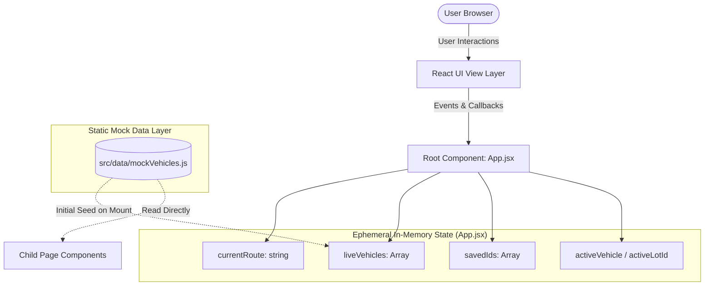
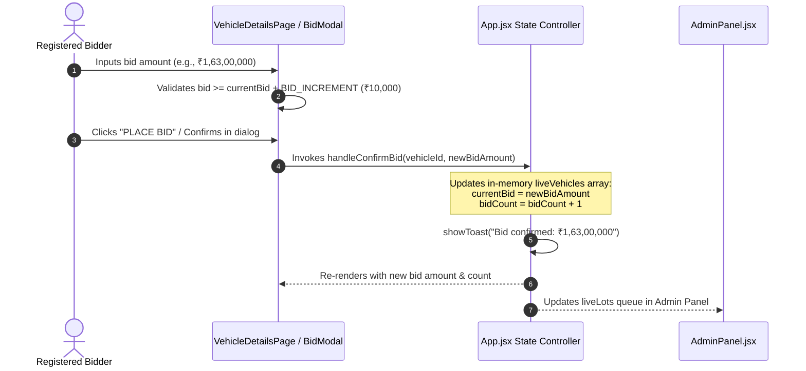
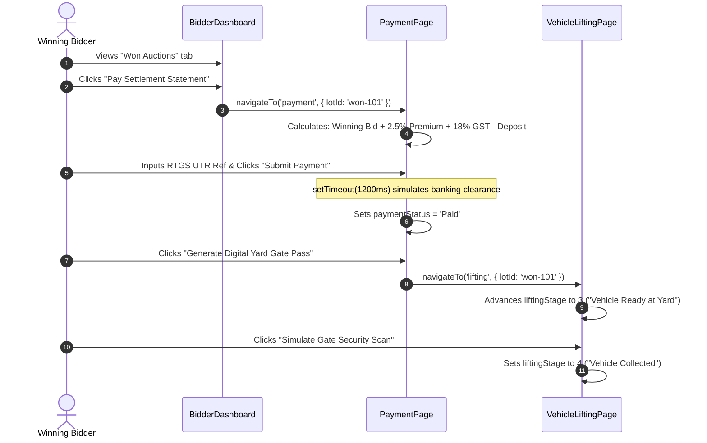

# 03 - ARCHITECTURE AND DATA FLOW

**Audited Target:** `src/App.jsx`, `src/components/`, `src/data/mockVehicles.js`  
**Auditor:** Senior Staff Engineer

---

## 1. High-Level Architecture Overview

The **Salvex Auction** web application is built as a **Single Page Application (SPA)** using React 19 and Vite. However, its architectural pattern departs from standard production React applications in several fundamental ways:

### Key Architectural Characteristics:
1. **Virtual String Routing (No URL Synchronization):**
   The application does not use the browser's URL bar, HTML5 History API (`pushState`), or a routing library like React Router. Instead, it maintains a single state variable `currentRoute` in `src/App.jsx:68`.
2. **Centralized Monolithic Controller (`App.jsx`):**
   `App.jsx` (531 LOC) acts as the state store, the router, the modal manager, and the toast notification dispatcher all at once.
3. **Static Seed Initialization:**
   Data is imported synchronously from `src/data/mockVehicles.js` into local React `useState` hooks. There is no caching layer (React Query / SWR), no global store (Redux / Zustand), and no persistence (`localStorage`).

---

## 2. Complete Routing & Navigation Map

Because routing is internal, all views exist as conditionally rendered branches within `<main className="salvex-main-route-outlet">` in `src/App.jsx:216-469`.

| Route Identifier (`currentRoute`) | Virtual URL Equivalent | Component Rendered | Public / Protected | Route Context Parameters |
| :--- | :--- | :--- | :---: | :--- |
| `'home'` | `/` | `Hero`, `SearchPanel`, `LiveAuctions`, `UpcomingAuctions`, etc. | Public | None |
| `'vehicles'` | `/vehicles` | `VehiclesPage.jsx` | Public | None (receives `liveVehicles`) |
| `'vehicle-details'` | `/vehicles/:id` | `VehicleDetailsPage.jsx` | Public | `activeVehicle` state |
| `'live-auctions'` | `/auctions/live` | `LiveAuctionsPage.jsx` | Public | Filtered inventory |
| `'upcoming-auctions'` | `/auctions/upcoming` | `UpcomingAuctionsPage.jsx` | Public | None |
| `'recently-added'` | `/vehicles/recent` | `RecentlyAddedPage.jsx` | Public | None |
| `'how-it-works'` | `/how-it-works` | `HowItWorksPage.jsx` | Public | None |
| `'bidding-rules'` | `/bidding-rules` | `BiddingRulesPage.jsx` | Public | None |
| `'about'` | `/about` | `AboutPage.jsx` | Public | None |
| `'contact'` | `/contact` | `ContactPage.jsx` | Public | None |
| `'faq'` | `/faq` | `FaqPage.jsx` | Public | None |
| `'privacy-policy'` | `/legal/privacy` | `LegalPage.jsx` (tab='privacy') | Public | None |
| `'terms-and-conditions'`| `/legal/terms` | `LegalPage.jsx` (tab='terms') | Public | None |
| `'refund-policy'` | `/legal/refund` | `LegalPage.jsx` (tab='refund') | Public | None |
| `'auction-policy'` | `/legal/auction` | `LegalPage.jsx` (tab='auction') | Public | None |
| `'login'` | `/login` | `LoginPage.jsx` | Public | Role redirection callback |
| `'list-your-vehicle'` | `/sell` | `ListVehiclePage.jsx` | Public (Demo) | 5-step wizard state |
| `'dashboard'` | `/bidder/dashboard` | `BidderDashboard.jsx` | Simulated Auth | Active bids, won lots |
| `'payment'` | `/checkout/:lotId` | `PaymentPage.jsx` | Simulated Auth | `activeLotId` parameter |
| `'lifting'` | `/logistics/:lotId` | `VehicleLiftingPage.jsx` | Simulated Auth | `activeLotId` parameter |
| `'seller-dashboard'` | `/seller/dashboard` | `SellerDashboard.jsx` | Simulated Auth | Sourced lots, sales analytics |
| `'admin'` | `/admin/operations` | `AdminPanel.jsx` | Simulated Auth | Live lots, KYC review queue |

---

## 3. Data Flow Diagrams

### Journey 1: Placing a Live Bid on a Vehicle Lot

### Journey 2: Post-Auction Winning Settlement & Gate Pass Clearance

---

## 4. Architectural Weaknesses & Evaluation

1. **Browser Navigation & Refresh Vulnerability:**
   Because routing is decoupled from the browser URL:
   - Clicking the browser's "Back" button navigates away from the entire website rather than going back to the previous screen.
   - Refreshing `F5` immediately reverts to `'home'`.
2. **Props Drilling:**
   `App.jsx` passes `liveVehicles`, `savedIds`, `handleToggleSave`, and `handleViewVehicleDetails` down through multiple layers of components instead of using React Context or a lightweight state store.
3. **Mixed State Lifecycles:**
   Some components duplicate state locally. For example, `VehicleDetailsPage.jsx:61` copies `vehicle.currentBid` into its own local state, while `AdminPanel.jsx:29` maintains an internal `liveLots` state that can fall out of sync with `App.jsx`.
