# 04 - FRONTEND COMPONENTS AND STATE MANAGEMENT DEEP DIVE

**Audited Target:** `src/components/`, `src/App.jsx`, `src/hooks/`  
**Auditor:** Senior Staff Engineer

---

## 1. Component Hierarchy & Classification

The codebase contains **56 files in `src/components/`** (including CSS files) and 2 files in `src/components/ui/`. The UI components break down into four distinct categories:

```mermaid
graph TD
    Root[App.jsx] --> Layout[Layout Components]
    Root --> Pages[Page-Level Views]
    Root --> Modals[Interactive Modals]
    Root --> Primitives[Shared Primitives & Widgets]

    Layout --> L1[Navbar.jsx]
    Layout --> L2[Footer.jsx]
    Layout --> L3[PortalBar.jsx]

    Pages --> P1[VehiclesPage.jsx]
    Pages --> P2[VehicleDetailsPage.jsx]
    Pages --> P3[LiveAuctionsPage.jsx]
    Pages --> P4[BidderDashboard.jsx]
    Pages --> P5[PaymentPage.jsx]
    Pages --> P6[VehicleLiftingPage.jsx]
    Pages --> P7[SellerDashboard.jsx]
    Pages --> P8[AdminPanel.jsx]
    Pages --> P9[ListVehiclePage.jsx]

    Modals --> M1[BidModal.jsx]
    Modals --> M2[VehicleModal.jsx]
    Modals --> M3[RegisterModal.jsx]
    Modals --> M4[ListVehicleModal.jsx]
    Modals --> M5[SavedModal.jsx]
    Modals --> M6[SearchModal.jsx]

    Primitives --> PR1[VehicleCard.jsx]
    Primitives --> PR2[SalvexLogo.jsx]
    Primitives --> PR3[PageLoader.jsx]
```

---

## 2. Comprehensive Component Inventory

| Component File | Size (LOC) | Classification | Primary Responsibility | Key Props Received |
| :--- | :---: | :--- | :--- | :--- |
| `App.jsx` | 531 | Application Root | State controller, virtual router, modal dispatcher | None |
| `Navbar.jsx` | 422 | Global Layout | Top navigation, search bar, currency selector, mobile drawer | `activeSection`, `onNavigate`, `savedCount` |
| `Footer.jsx` | 215 | Global Layout | Multi-column links, legal disclaimers, newsletter form | `onNavigate`, `onOpenBidderModal` |
| `Hero.jsx` | 134 | Homepage Section | 3-slide animated carousel, primary CTA buttons | `onSearchClick`, `onLiveAuctionsClick` |
| `SearchPanel.jsx` | 196 | Homepage Section | Filter bar (Make, Type, Location, Year, Price) | `activeTab`, `filters`, `onSearch` |
| `LiveAuctions.jsx` | 114 | Homepage Section | Horizontal carousel of live bidding lots | `vehicles`, `onPlaceBid`, `savedIds` |
| `UpcomingAuctions.jsx` | 98 | Homepage Section | Grid preview of scheduled auction lots | `auctions`, `onViewAuction` |
| `RecentlyAddedVehicles.jsx`| 62 | Homepage Section | List of recently added inventory | `vehicles`, `onViewDetails`, `savedIds` |
| `WhySalvex.jsx` | 185 | Homepage Section | 4-pillar trust features (Transparency, Escrow, etc.) | `features` |
| `AboutSection.jsx` | 89 | Homepage Section | Summary of Salvex remarketing exchange | `onAboutClick` |
| `BuyerCta.jsx` | 52 | Homepage Section | Conversion banner for buyer onboarding | `onRegisterClick`, `onExploreClick` |
| `VehiclesPage.jsx` | 496 | Page View | Inventory catalog with filters, search, and sorting | `vehicles`, `savedIds`, `onToggleSave` |
| `VehicleDetailsPage.jsx` | **1,356** | Page View | 3-column detail view, photo gallery, bid box, tabs | `vehicle`, `savedIds`, `similarVehicles` |
| `LiveAuctionsPage.jsx` | 482 | Page View | Live auction lots with status chips and filters | `vehicles`, `savedIds`, `onPlaceBidQuick` |
| `UpcomingAuctionsPage.jsx`| 420 | Page View | Scheduled auctions with countdown and reminder alerts | `auctions`, `onSetReminder` |
| `RecentlyAddedPage.jsx`| 264 | Page View | New additions with time badges | `vehicles`, `savedIds`, `onViewDetails` |
| `HowItWorksPage.jsx` | 168 | Page View | Comprehensive 4-step buyer and seller guide | `onRegisterClick`, `onExploreClick` |
| `BiddingRulesPage.jsx` | 278 | Page View | 10 compliance rules, EMD deposits, increments | `onRegisterClick` |
| `AboutPage.jsx` | 312 | Page View | Mission, leadership, facility tour, trust metrics | `onExploreClick`, `onRegisterClick` |
| `ContactPage.jsx` | 468 | Page View | Inquiry form, regional offices, customer support | `onShowToast`, `onNavigate` |
| `FaqPage.jsx` | 192 | Page View | Accordion FAQ categories | `onContactClick`, `onRegisterClick` |
| `LegalPage.jsx` | 148 | Page View | Multi-tab legal policy viewer | `initialTab` |
| `LoginPage.jsx` | 277 | Auth View | Password/OTP login with role persona switcher | `onLoginSuccess`, `onShowToast` |
| `ListVehiclePage.jsx` | 548 | Workflow View | 5-step consignor vehicle onboarding wizard | `onSubmitSuccess`, `onShowToast` |
| `BidderDashboard.jsx` | **873** | Workflow View | Buyer portal (bids, won lots, documents, wallet) | `savedVehicles`, `onNavigatePayment` |
| `PaymentPage.jsx` | 325 | Workflow View | Invoice calculation, taxes, RTGS UTR checkout | `lotId`, `onNavigateLifting`, `onShowToast`|
| `VehicleLiftingPage.jsx` | 267 | Workflow View | Yard pass, QR code clearance, logistics dispatch | `lotId`, `onNavigateDashboard` |
| `SellerDashboard.jsx` | 284 | Workflow View | Consignor performance metrics and listings queue | `onNavigateListVehicle`, `onShowToast` |
| `AdminPanel.jsx` | **642** | Workflow View | Operations command desk (KYC review, lot control) | `liveLots`, `onExtendLot`, `onShowToast` |
| `VehicleCard.jsx` | 312 | Reusable Primitive| Auction vehicle card with countdown timer & save heart| `vehicle`, `isSaved`, `onToggleSave` |
| `BidModal.jsx` | 215 | Interactive Dialog| Quick bid submission modal with +₹1L/+₹2L pills | `vehicle`, `isOpen`, `onConfirmBid` |
| `VehicleModal.jsx` | 172 | Interactive Dialog| Quick spec modal | `vehicle`, `isOpen`, `onPlaceBid` |
| `RegisterModal.jsx` | 448 | Interactive Dialog| Bidder signup modal with KYC step simulation | `isOpen`, `onClose` |
| `ListVehicleModal.jsx` | 185 | Interactive Dialog| Quick sell modal | `isOpen`, `onClose` |
| `SavedModal.jsx` | 118 | Interactive Dialog| Watchlist slide-over drawer | `isOpen`, `savedVehicles`, `onRemoveSaved` |
| `SearchModal.jsx` | 104 | Interactive Dialog| Search dialog with instant filter matches | `isOpen`, `allVehicles`, `onSelectVehicle` |
| `PageLoader.jsx` (ui) | 120 | Visual Animation | Startup preloader with brand intro | `onLoadingComplete` |

---

## 3. State Management & Prop-Drilling Analysis

### Global State in `App.jsx`:
- `showPreloader` (boolean): Controls preloader visibility on initial mount.
- `liveVehicles` (array): The in-memory auction catalog initialized from `liveVehiclesData`.
- `savedIds` (array): User's watchlist (`['salvex-101', 'salvex-103']`).
- `currentRoute` (string): Active route identifier.
- `activeVehicle` (object): Selected vehicle passed to `VehicleDetailsPage`.
- `activeLotId` (string): Selected lot for checkout/lifting (`'won-101'`).
- `toastMessage` (string | null): Global toast message.

### Prop-Drilling Hotspots:
1. **Watchlist State (`savedIds` & `handleToggleSave`):**
   Passed from `App.jsx` into `Navbar`, `LiveAuctions`, `RecentlyAddedVehicles`, `VehiclesPage`, `VehicleDetailsPage`, `LiveAuctionsPage`, `RecentlyAddedPage`, `VehicleCard`, `VehicleModal`, and `SavedModal`.
2. **Vehicle Details Navigation (`handleViewVehicleDetails`):**
   Passed down across 12 distinct components to allow clicking vehicle cards to navigate to details.

---

## 4. Forms, Validation & Error States

| Form Location | Fields & Inputs | Validation Implemented | Error Handling | Loading / Empty State |
| :--- | :--- | :--- | :--- | :--- |
| **Login (`LoginPage.jsx:32-57`)** | Email/Mobile, Password, OTP | Basic string emptiness; checks for string contains `"suspended"` or `"pending"`. | Banner alerts (`.login-alert-banner alert-error`). | 750ms `setTimeout` with loading spinner. |
| **Bid Submission (`VehicleDetailsPage.jsx:123-134`)** | Custom bid numeric input | Validates `bidAmount >= minNextBid` and `secondsRemaining > 0`. | Native browser `alert()` popups. | Confirmation modal step. |
| **Vehicle Listing Wizard (`ListVehiclePage.jsx:81-91`)** | 20+ fields (Make, Model, Year, Fuel, Damage, Photos) | HTML5 `required` attributes across 5 wizard steps. | Minimal inline validation. | 800ms submission spinner. |
| **Payment Checkout (`PaymentPage.jsx:52-62`)** | Payment method radio, UTR reference input | HTML5 required input. | None. | 1,200ms processing delay. |
| **Contact Support (`ContactPage.jsx`)** | Name, Email, Phone, Category, Message | Basic required field checks. | Toast feedback. | Immediate toast confirmation. |

---

## 5. Hardcoded Content & Mock Data Audit

The codebase relies on extensive mock records defined in `src/data/mockVehicles.js` (34KB):
1. **`liveVehiclesData` (6 vehicle lots):**
   - Lots: `salvex-101` (Porsche 911 GT3), `salvex-102` (Mercedes-AMG G63), `salvex-103` (Land Rover Defender 110), `salvex-104` (Audi RS6), `salvex-105` (Mercedes S-Class), `salvex-106` (Maruti Swift ZXi+).
2. **`upcomingAuctionsData` (4 scheduled lots):**
   - Institutional lots scheduled across Bengaluru, Mumbai, Delhi, and Chennai.
3. **`wonAuctionsData` (4 simulated settlement records):**
   - Won lots used to populate `BidderDashboard`, `PaymentPage`, and `VehicleLiftingPage`.
4. **`pendingKycReviewData` (4 users) & `sellerListingsData` (5 listings):**
   - Used to populate the queues in `AdminPanel.jsx`.

### Placeholder Text & Demo Notes:
Components explicitly label simulated features with "(demo)" tags:
- `LoginPage.jsx:80`: `"Secure settlement (demo)"`
- `PaymentPage.jsx:74`: `"Settlement & Invoice Checkout (Demo)"`
- `VehicleLiftingPage.jsx:30`: `"Secure settlement (demo) confirmed"`
- `SellerDashboard.jsx:61`: `"Institutional Consignor (Demo)"`
