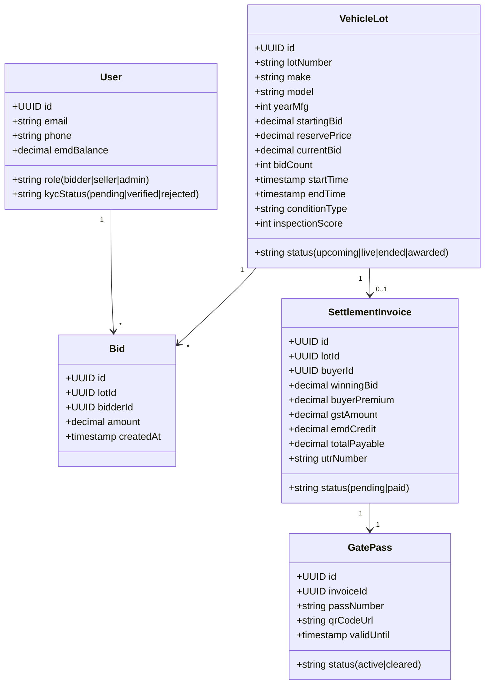
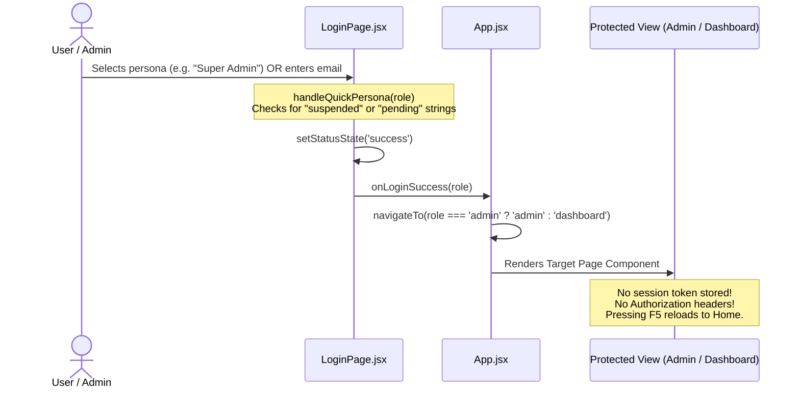

# 06 - BACKEND, APIS, DATABASE & AUTHENTICATION AUDIT

**Audited Target:** Entire codebase (`src/`, configuration files, root)  
**Auditor:** Senior Staff Engineer

---

## 1. Backend Presence & Architecture Verdict

```
Grep Query: /api/|fetch\(|axios|http://|https://api|websocket|socket.io
Result: 0 API client instances found in src/
```

### Critical Statement:
**There is NO backend server, NO database connection, and NO real API integration in this project.**

The entire application runs **client-side in the user's browser memory**. All records (vehicle specifications, lot numbers, bids, inspection scores, seller listings, and user accounts) originate from static JavaScript mock objects located in:
`src/data/mockVehicles.js` (34,000 bytes, ~750 lines of static JSON/JS objects).

---

## 2. Simulated Endpoints vs. Future Real Backend Contracts

To transition this prototype into a production platform, the following API contracts and database schema must be implemented by the backend engineering team:



### Proposed REST / WebSocket Endpoint Map:
| Proposed Endpoint | Method | Intended Purpose | Current Client Implementation |
| :--- | :---: | :--- | :--- |
| `/api/v1/auth/login` | POST | Authenticate user, issue JWT/HttpOnly session | `LoginPage.jsx:32-57` (`setTimeout` mock) |
| `/api/v1/auth/register` | POST | Register new bidder, upload KYC proofs | `RegisterModal.jsx` (local state) |
| `/api/v1/vehicles` | GET | Paginated, faceted search catalog | Filtered in-memory array (`VehiclesPage.jsx`) |
| `/api/v1/vehicles/:id` | GET | Single vehicle lot details, specs & images | `activeVehicle` prop passed from `App.jsx` |
| `/api/v1/auctions/live` | GET | Stream of active lots | Filtered `liveVehicles` state |
| `/api/v1/auctions/:id/bid` | POST | Commit live bid with locking & EMD check | `handleConfirmBid` in `App.jsx:158` (in-memory) |
| `/ws/auctions/:id` | WSS | Real-time bid updates & timer synchronization | Client `setInterval` in `VehicleDetailsPage.jsx:98` |
| `/api/v1/settlements/:lotId`| GET | Generate tax invoice & EMD adjustments | Calculated in `PaymentPage.jsx:32-37` |
| `/api/v1/settlements/:lotId/pay`| POST | Verify bank UTR or process gateway checkout | `handleSimulatePayment` (`PaymentPage.jsx:52`) |
| `/api/v1/logistics/:lotId/gate-pass`| GET | Digital gate pass with encrypted QR signature | Rendered statically in `VehicleLiftingPage.jsx:96` |
| `/api/v1/admin/kyc/review` | PATCH| Approve or reject bidder KYC documents | Mutates `kycQueue` in `AdminPanel.jsx:51` |
| `/api/v1/admin/lots/:id/extend` | POST| Anti-sniping overtime extension (+120s) | Mutates `endsInSeconds` in `App.jsx:175` |

---

## 3. Third-Party Integrations & Services Review

| Category | Service Implied in UI | Real Integration Present? | Audit Finding |
| :--- | :--- | :---: | :--- |
| **Payment Gateway** | Razorpay / Cashfree / RTGS Escrow | **NO** | No payment SDK script included; users type a dummy UTR number. |
| **SMS / OTP Service** | MSG91 / Twilio / Karix | **NO** | OTP form in `LoginPage.jsx:27` accepts any numeric entry. |
| **Cloud Object Storage**| AWS S3 / Cloudinary / GCP Bucket | **NO** | Image uploads in `ListVehiclePage.jsx` toggle boolean flags instead of uploading files. |
| **Authentication & IAM**| Auth0 / Supabase / Firebase / Cognito | **NO** | Fully custom dummy state. Any email with password passes. |
| **Analytics & Telemetry**| Google Analytics / PostHog / Sentry | **NO** | Zero tracking scripts or error logging SDKs installed. |
| **Digital Document Signing**| Aadhaar eSign / Leegality / DocuSign | **NO** | RTO Form 29/30 download buttons trigger dummy actions. |

---

## 4. Authentication and Authorization Flow Breakdown



### Security Deficiencies in Current Auth Implementation:
1. **Zero Access Guarding:**
   Any user can access `currentRoute === 'admin'` simply by calling `navigateTo('admin')` in the React console or clicking the admin button.
2. **Ephemeral Identity:**
   User identity is not persisted in cookies, `localStorage`, or session storage. 
3. **No Role-Based Authorization:**
   Components like `AdminPanel.jsx` permit selecting any operational role ("Super Admin", "KYC Manager", "Finance Manager") from an unauthenticated dropdown menu (`AdminPanel.jsx:23`).
