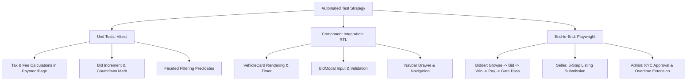

# 11 - TESTING, QUALITY ASSURANCE & DEPLOYMENT PIPELINE

**Audited Target:** `package.json`, git history, configuration files  
**Auditor:** Senior Staff Engineer

---

## 1. Existing Automated Testing Status

```
Grep Query: test|spec|jest|vitest|cypress|playwright
Result: 0 test files or configurations found.
```

### Critical Statement:
**There are ZERO automated tests in this entire repository.**
- No unit tests (Vitest / Jest).
- No component tests (React Testing Library).
- No end-to-end tests (Playwright / Cypress).
- No test script declared in `package.json:6-11` (only `"dev"`, `"build"`, `"lint"`, `"preview"` exist).

---

## 2. High-Risk Untested Surface Areas

Without automated test coverage, the following business-critical workflows are vulnerable to silent regressions during future design or feature updates:

1. **Anti-Sniping Countdown Overtime Math (`App.jsx:175`, `VehicleDetailsPage.jsx:81-101`):**
   A timer calculation bug could allow users to submit bids after an auction has closed, or lock users out prematurely.
2. **Bid Increment Validation (`VehicleDetailsPage.jsx:129`):**
   Verifying that `bidAmount >= currentBid + BID_INCREMENT` (₹10,000) is critical to auction integrity.
3. **Invoice Tax & Settlement Calculations (`PaymentPage.jsx:32-37`):**
   Accurately calculating the 2.5% platform premium, 18% GST on fees, and deducting the Earnest Money Deposit. A regression here impacts financial settlements.
4. **Faceted Search Multi-Filter Logic (`VehiclesPage.jsx:65-95`):**
   Combining multiple active filters (Make + Price + Fuel + Location) can result in blank screens if falsy values or undefined fields are encountered.

---

## 3. Recommended Minimum Test Suite (Before Launching Major Redesign)



### Setup Steps for Testing:
1. **Install Vitest & React Testing Library:**
   ```bash
   npm install -D vitest @testing-library/react @testing-library/jest-dom jsdom
   ```
2. **Add Script to `package.json`:**
   ```json
   "scripts": {
     "test": "vitest",
     "test:run": "vitest run"
   }
   ```

---

## 4. Build, CI/CD & Deployment Assessment

### Build Configuration (`vite.config.js`):
```javascript
import react from '@vitejs/plugin-react'
import { defineConfig } from 'vite'

export default defineConfig({
  plugins: [react()],
  server: {
    host: true,
    port: 5173
  }
})
```
- Standard Vite configuration. Clean and fast (~1.4s production build).
- Output targets standard static hosting (HTML/CSS/JS in `/dist`).

### CI/CD & Hosting Gaps:
- **No CI/CD Pipeline:** No `.github/workflows/`, GitLab CI, or Bitbucket pipelines exist in the repository. Pull requests are not automatically linted or built.
- **Hosting Target:** The build output (`/dist`) can be hosted on any static cloud edge network (Vercel, Netlify, Cloudflare Pages, AWS S3 + CloudFront).
- **Single-Page Application Fallback:**
  Because this is a client-side SPA, the production web server (Nginx, Netlify, or Vercel) must be configured to route all incoming requests to `/index.html` (rewrite rule: `/* -> /index.html 200`).
