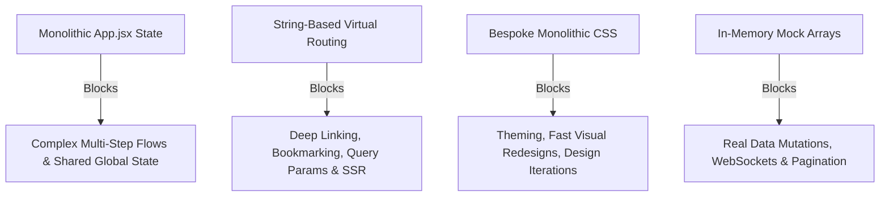

# 12 - FUTURE-FEATURE EXTENSION GUIDE

**Audited Target:** Architecture and code conventions of `beta-salvex`  
**Auditor:** Senior Staff Engineer

---

## 1. How to Add New Features in This Codebase (Current Architecture)

For developers taking over the project before a major refactoring, follow these established codebase conventions to add new views, components, and workflows.

### A. How to Add a New Page / Route

1. **Create the Component & Stylesheet:**
   Create `src/components/MyNewPage.jsx` and `src/components/MyNewPage.css`.
2. **Register the Import in `src/App.jsx`:**
   ```javascript
   import MyNewPage from './components/MyNewPage';
   ```
3. **Add the Route String to `App.jsx`:**
   Update the comment on `App.jsx:67` and add the conditional branch inside `<main className="salvex-main-route-outlet">`:
   ```jsx
   {currentRoute === 'my-new-page' && (
     <MyNewPage
       onNavigateHome={() => navigateTo('home')}
       onShowToast={showToast}
     />
   )}
   ```
4. **Link the Route in `src/components/Navbar.jsx` & `Footer.jsx`:**
   Add `{ id: 'my-new-page', label: 'My Feature' }` to the `navItems` array in `Navbar.jsx:70`.

### B. How to Add a New Shared Modal Dialog

1. **Create the Modal:**
   Create `src/components/MyNewModal.jsx` accepting `isOpen`, `onClose`, and action callbacks.
2. **Manage State in `src/App.jsx`:**
   ```javascript
   const [isMyModalOpen, setIsMyModalOpen] = useState(false);
   ```
3. **Mount in `App.jsx` Portal Section:**
   Render `<MyNewModal isOpen={isMyModalOpen} onClose={() => setIsMyModalOpen(false)} />` near `App.jsx:480`.

---

## 2. Architectural Bottlenecks That Will Block New Features

If you attempt to build advanced production features on the current architecture without refactoring, you will encounter the following blockers:



1. **State Explosion in `App.jsx`:**
   Adding new features (e.g. notifications center, real-time bid chat, user profile management) will bloat `App.jsx` beyond its current 531 lines and create cascading re-renders across all child components.
2. **Lack of URL Query Parameter Support:**
   Currently, filter states (e.g., `?make=BMW&priceMax=5000000`) cannot be shared or bookmarked because there is no URL synchronization.
3. **CSS Specificity Clashes:**
   Adding new page styles into global stylesheets risks breaking existing layouts due to class name collisions.

---

## 3. Recommended Refactoring Roadmap

### Phase 1: Essential Refactors (Complete BEFORE Major Redesign or Backend Integration)
1. **Migrate to React Router v7 or TanStack Router:**
   Convert string routes into real URL-driven routes with loaders, layout wrappers, and dynamic params (`/vehicles/:id`).
2. **Decompose `VehicleDetailsPage.jsx` into Modular Subcomponents:**
   Break the 1,356-line component into `VehicleGallery.jsx`, `VehicleSpecsGrid.jsx`, `BiddingPanel.jsx`, and `VehicleTabs.jsx`.
3. **Extract Business Math into Pure Functions:**
   Move all tax, increment, and countdown logic into `src/utils/`.

### Phase 2: Design System Decoupling
1. **Consolidate Design Tokens:**
   Replace hardcoded hex codes across all CSS files with standardized CSS custom properties in `src/index.css`.
2. **Build Shared UI Primitives:**
   Create reusable `<Button>`, `<Input>`, `<Badge>`, and `<Card>` primitives in `src/components/ui/`.
3. **Optimize Asset Delivery:**
   Compress and convert all 16MB of images in `public/images/` to WebP/AVIF.

### Phase 3: Backend & Data Integration
1. **Integrate TanStack Query (React Query):**
   Replace static imports from `mockVehicles.js` with asynchronous query hooks.
2. **Implement WebSocket Listener:**
   Connect `VehicleDetailsPage` and `LiveAuctions` to a WebSocket server for real-time bid updates and anti-sniping timer synchronization.
3. **Implement Real Auth Guards:**
   Add session management and protect `/admin` and `/dashboard` routes.
